# PickAndPlace


<p align="center">
  
</p>


## Table of Contents
- [Description](#description)
- [Why I built it](#why-i-built-it)
- [Features](#features)
- [Requirements](#requirements)
- [Build Photos](#build-photos)
- [3D Models](#3d-models)
- [Electronics](#electronics)
- [Controls](#controls)
- [Tech Stack](#tech-stack)
- [Architecture](#architecture)
- [Installation](#installation)
- [Project Structure](#project-structure)
- [Planned Features](#planned-features)
- [Bill of materials](#bill-of-materials)
- [Screws](#screws)
- [Tools](#tools)


## Description
I built PickAndPlace, a DIY SMD pick-and-place machine and solder paste dispenser, from an old Creality CR-10S.
A **Raspberry Pi 5** is the main controller (jobs, display, cameras, website). A **Bigtreetech Octopus** is the motor and sensor controller.
The Z-Axsis is a *seesaw* mechanism: one motor lowers the vacuum picker while it raises the paste syringe,
and the other way round.

More details:
- [SOFTWARE.md](SOFTWARE.md): Pi setup, building, the display, the website, simulation
- [UI.md](UI.md): every screen, website page and setting
- [BOM.csv](BOM.csv): the bill of materials as CSV


## Why I built it
I wanted to learn, and I wanted a project I could spend a lot of time on and end up with something cool.
A pick-and-place machine was a good fit: it needs mechanics, electronics, firmware, computer vision and a user
interface, and it turns an old CR-10S into a machine that builds my own PCBs.


## Features
- Seesaw Z head: picker and paste syringe on one motor
- Solder paste dispenser
- Nozzle rotation with a NEMA 8 hollow-shaft motor
- Automatic nozzle changer with 5 Juki slots and a sensor in each slot
- Bottom camera corrects the offset and rotation of every part
- Top camera finds fiducials and tape pockets
- Feeders on their own gantry, found by auto-detect and QR codes
- Vacuum sensor catches failed picks and retries
- Load cell measures the nozzle tip height
- Sensorless homing (no limit switches needed)
- 3.5" touch display with a joystick on the machine
- Website with live cameras, step-by-step calibration and a display mirror
- Firmware updates for the Octopus over USB from the Pi
- Simulation mode: the full software runs without the machine


## Requirements
- Raspberry Pi 5 (a Pi 3B+ works as well) with Raspberry Pi OS Bookworm, 64-bit
- BTT Octopus V1.1 with TMC2209 drivers
- 12 V / 30 A power supply, plus 5 V / 5 A for the Pi
- Two USB cameras (top and bottom)
- A 3D printer for the printed parts
- Node.js and `build-essential` on the Pi


## Build Photos
| | |
|:-:|:-:|
| 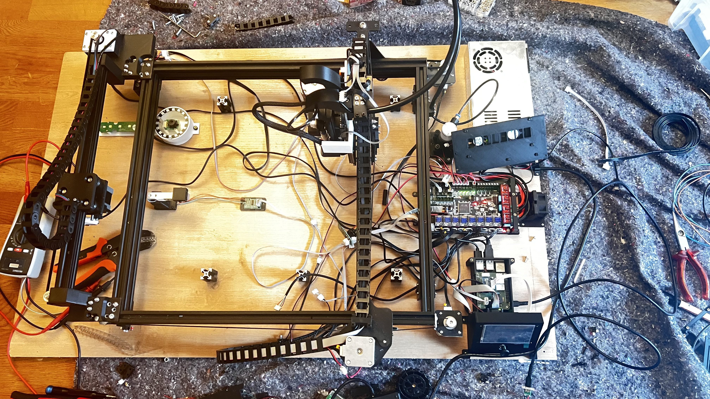<br>The machine so far: frame, gantry, electronics on the MDF base | 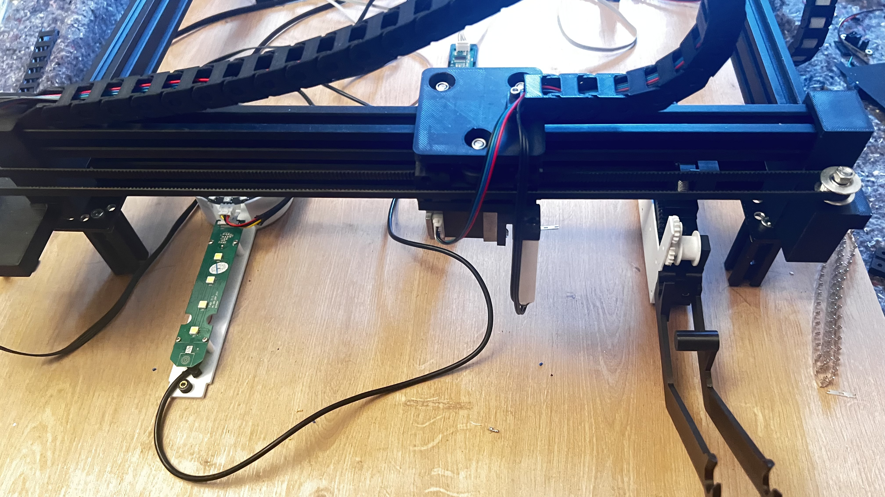<br>Feeder rail with its cable chain |
| 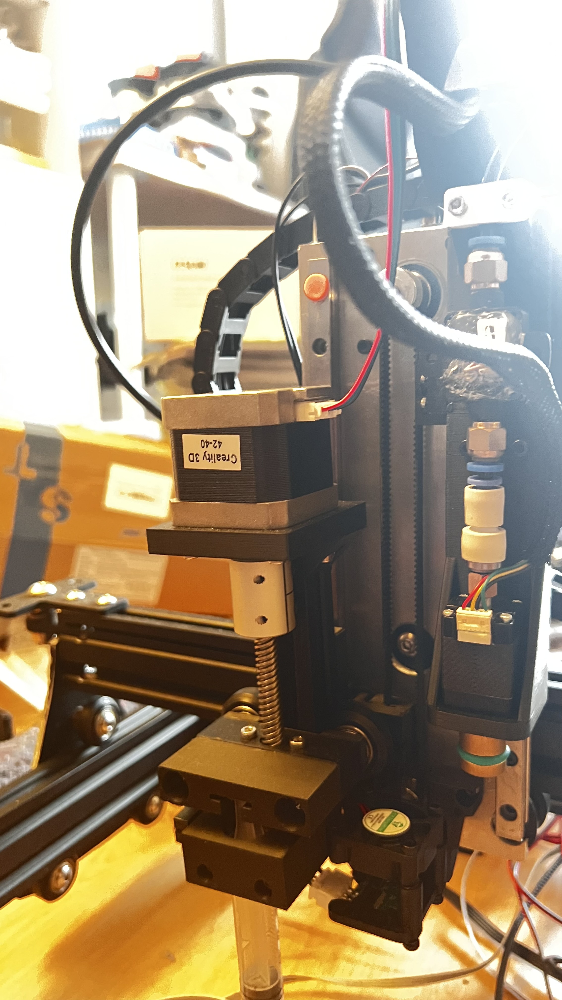<br>The head on the Y-carriage | 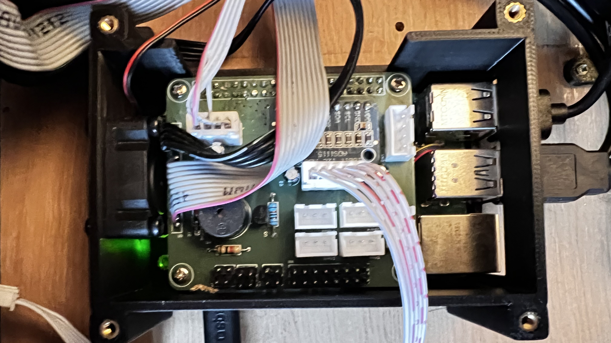<br>Raspberry Pi 5 with the carrier board in its housing |


## 3D Models
I designed the models in Fusion 360 [models/](models/).
Each Unit has its own folder. `assembly.step` has everything in place, the other files are the single parts.

### Head (seesaw Z)
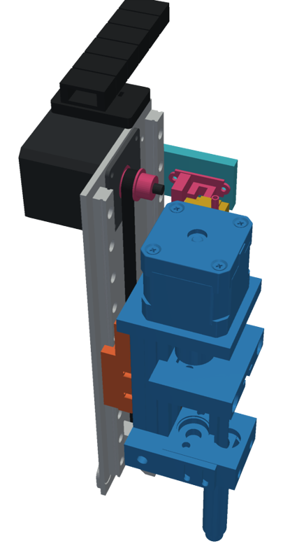

I bolted a 3 mm aluminium plate with two MGN9 rails onto the CR-10 Y-carriage.
A NEMA17 at the top drives one GT2 belt loop.

- Travel ±62 mm, working stroke ~±55 mm
- Optical home sensor in the centre
- Top camera in front

[models/head-mount](models/head-mount/) · picker bracket: [models/nema8-90deg-mount](models/nema8-90deg-mount/)

<br clear="right">

### Nozzle changer
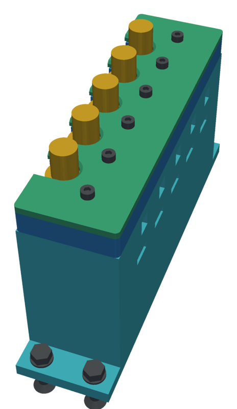

Five slots for Juki 500 nozzles.
The nozzle slides in from the front. When the head lifts, the lid holds the collar and pulls the nozzle off.
A TCRT5000 sensor behind each slot detects if a nozzle is there.

[models/juki-tool-changer](models/juki-tool-changer/)

<br clear="right">

### Feeders


Tape feeders for 7" reels on their own rail (the feeder gantry).
Each feeder has a sprocket drive, a peel-off spool, a WS2812 status LED and a QR code.

[models/feeder](models/feeder/)

<br clear="right">

### More units
| | | |
|:-:|:-:|:-:|
| 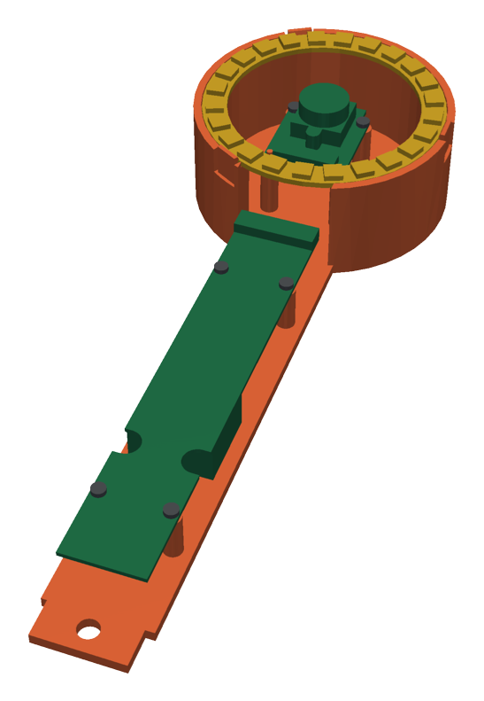<br>**Bottom camera**<br>up-looking camera with a 16-LED ring · [folder](models/bottom-camera/) | 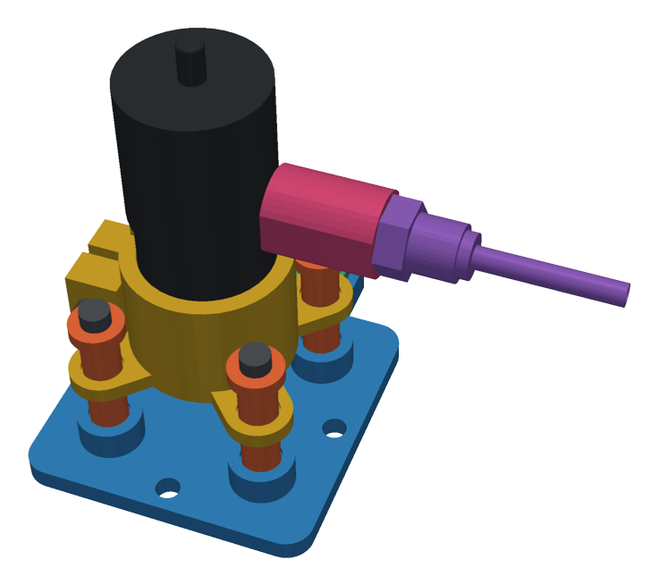<br>**Vacuum pump**<br>sits on springs to soak up vibration · [folder](models/pump-mount/) | 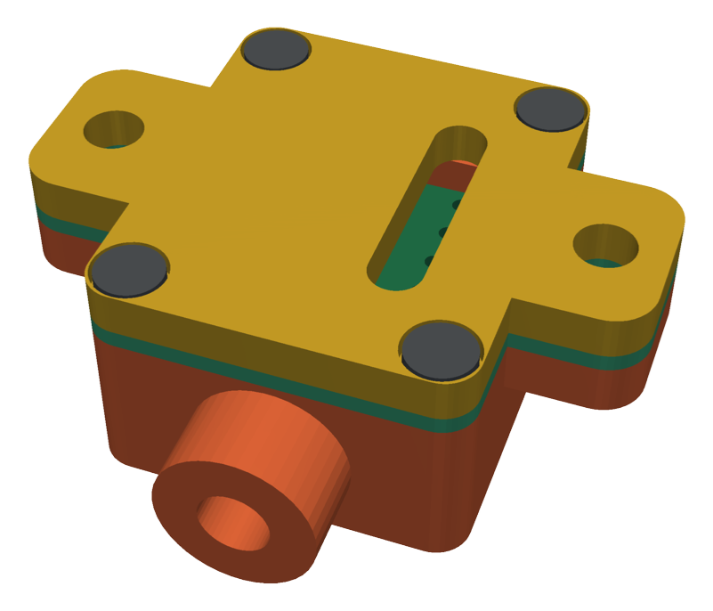<br>**Vacuum sensor**<br>sealed BMP280 housing on the hose · [folder](models/vacuum-sensor/) |
| 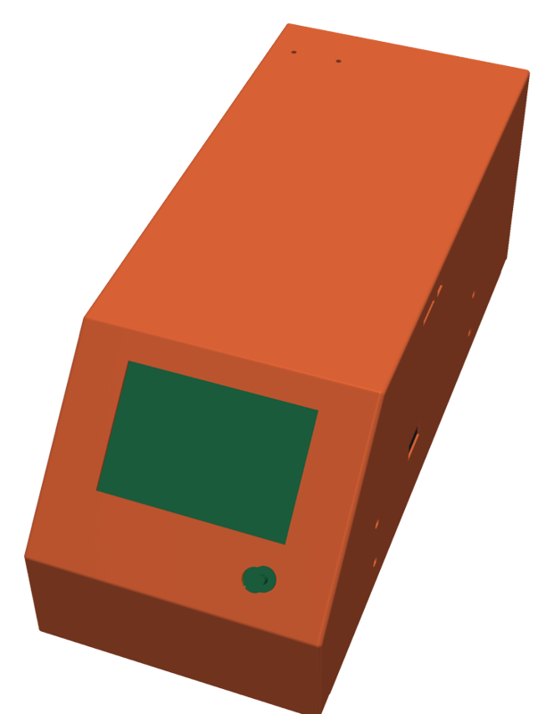<br>**Control box**<br>CR-10S housing with the Octopus and display · [folder](models/control-box/) | <br>**Octopus mount**<br>board and driver fans on the MDF · [folder](models/octopus-mount/) | 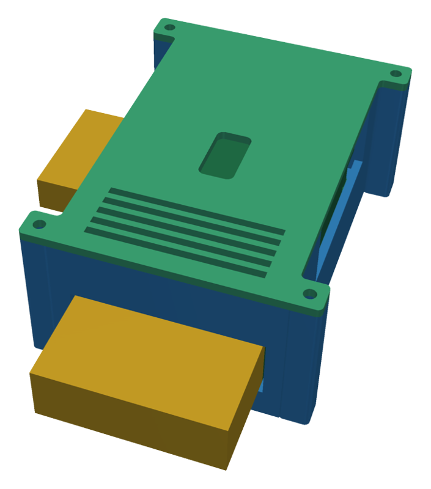<br>**Pi housing**<br>Pi 5, carrier board and a 30 mm fan · [folder](models/pi-housing/) |
| 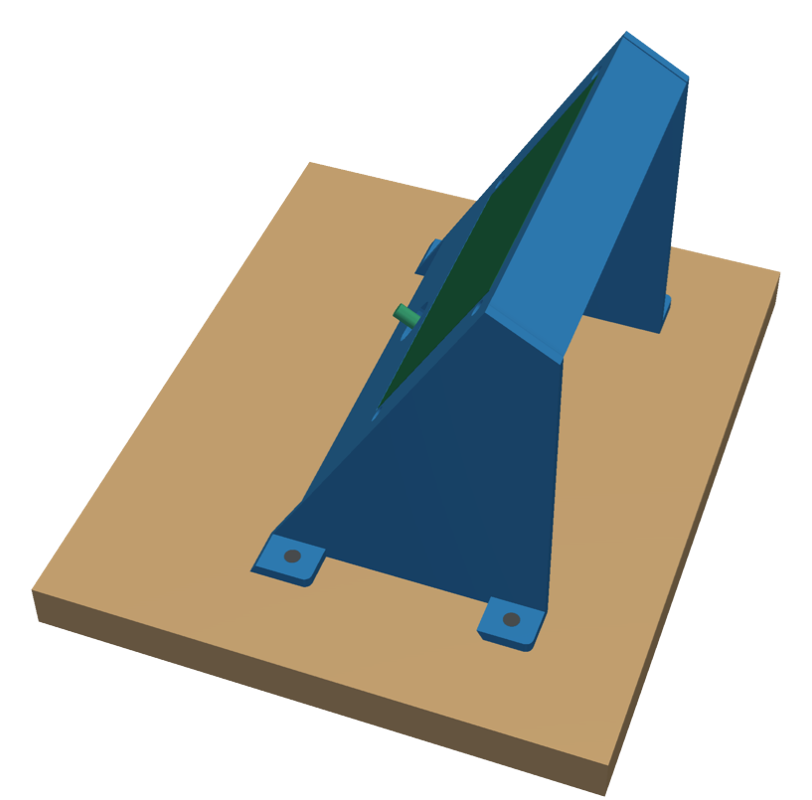<br>**Display console**<br>3.5" touch display and joystick · [folder](models/display-mount/) | <br>**CR-10S display adapter**<br>display in the original CR-10S box · [folder](models/cr10s-display-adapter/) | 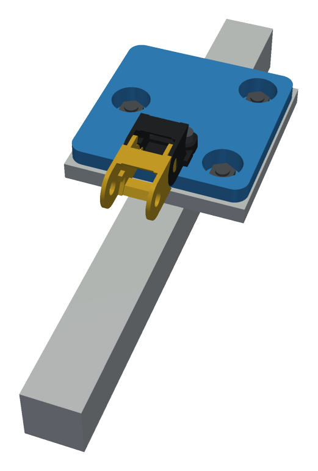<br>**Cable chain mount**<br>on a 2020 V-wheel carriage · [folder](models/chain-mount/) |
| <br>**Cable clamps**<br>for round and flat cables · [folder](models/cable-clamp/) | 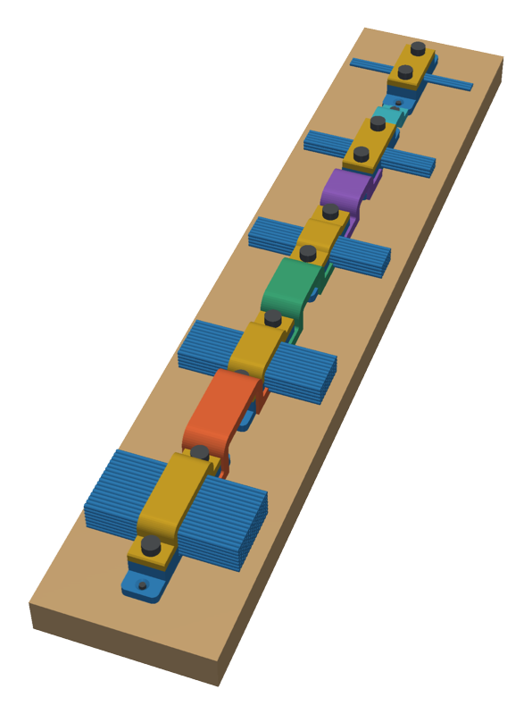<br>**Wire holders**<br>on the MDF · [folder](models/wire-holder/) | <br>**Box fan stand**<br>fan for the control box · [folder](models/box-fan-mount/) |


## Electronics
### Carrier board schematic


I designed a small board for the Pi's 40-pin header.
It holds the ADS1115 for the joystick, the buzzer and connectors for the display, the vacuum sensor, the joystick
and the start / pause / stop buttons.

### PCB
| Front | Back |
|:-:|:-:|
|  |  |

Front and back layer of the carrier board.

### Wiring


Every connection from the Pi to the display, joystick, sensors, buzzer and cameras, plus the motors, inputs
and outputs on the Octopus.

### Octopus pin by pin
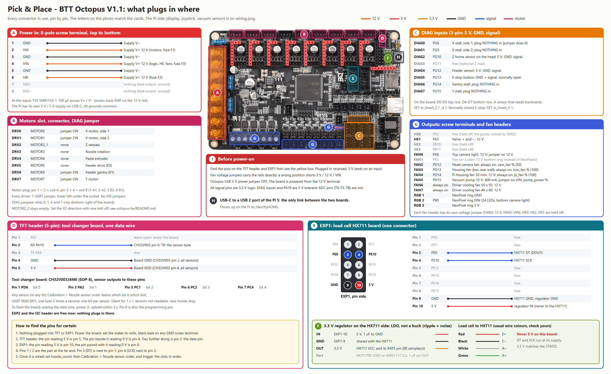

The Octopus connectors pin by pin.

| Octopus slot | Motor |
|---|---|
| DRV0 / DRV1 | X, both sides (sensorless homing) |
| DRV2 | Z seesaw (home flag) |
| DRV3 | Nozzle rotation (NEMA 8) |
| DRV4 | Paste extruder |
| DRV5 | Feeder feed |
| DRV6 | Feeder gantry (sensorless homing) |
| DRV7 | Y (sensorless homing) |


## Controls
### Display
- Tap → press a button
- Drag → scroll
- Joystick up / down → move the focus
- Joystick left → back
- Joystick button → press
- Hold the joystick button → back
- Joystick on Move / Teach / Cameras → jog X / Y (button switches to Z / E1)

### Website
- `http://pickandplace.local`
- Password → shown on the display under Menu → Network & website
- Display page → click = touch

All screens and settings are in [UI.md](UI.md).


## Tech Stack
- C++17 (`pap-core`: jobs, display, vision, Octopus link)
- TypeScript + Node.js (`pap-web`: website)
- PlatformIO / STM32 (`octopus-fw`: motion firmware)
- LovyanGFX (display)
- Fusion 360 (3D models)
- EasyEDA / KiCad (carrier board)


## Architecture
The Pi does the thinking, the Octopus does the moving.
They talk over USB with a simple text protocol.

```
 browser ──HTTP/WebSocket──> pap-web (TypeScript) ──TCP 127.0.0.1:7070──┐
                                                                         v
 display + touch + joystick <── UI thread ──── pap-core (C++) ── controller thread: jobs, feeders,
 BMP280 / ADS1115 (I2C) ───────────────────────┘    │    settings, vision, calibration
 USB cameras (V4L2) ───────────────────────────────-┘    └── USB ──> Octopus (motion, endstops, outputs)
```

- Vision runs without OpenCV
- Settings are stored on the Pi (`~/pap-data`), machine values on the Octopus
- The Octopus stops by itself if the Pi goes silent while it moves


## Installation
### Pi
First enable **SPI** and **I2C** in `sudo raspi-config` and set the hostname to `pickandplace`
(the services expect the user `pnp`), then:
```bash
sudo apt install build-essential nodejs npm
git clone https://github.com/Dari2008/PickAndPlace.git ~/pap
cd ~/pap/core && make -j4
cd ~/pap/web && npm install && npm run build
sudo cp ~/pap/deploy/pap-*.service /etc/systemd/system/
sudo systemctl enable --now pap-core pap-web
```

### Octopus
Flash the firmware once by microSD card, after that the Pi can update it over USB:
```bash
cd octopus-fw
pio run
```
See [octopus-fw/README.md](octopus-fw/README.md).

### Without the machine
```bash
cd core && make -j8 && make test
./build/pap-core --sim --data /tmp/pap --console
```
On Windows just double-click `ui-preview.cmd`. Everything is in [SOFTWARE.md](SOFTWARE.md).


## Project Structure
- core/        - pap-core (C++): jobs, display UI, vision, Octopus link
- web/         - pap-web (TypeScript): website
- octopus-fw/  - Octopus firmware (PlatformIO)
- models/      - 3D models as STEP, one folder per unit
- hardware/    - wiring diagrams
- images/      - photos, renders, schematic and PCB
- deploy/      - systemd services
- tools/       - Windows preview of the display and website
- BOM.csv      - bill of materials


## Planned Features
- [x] Software for the Pi and the Octopus (tested in the simulator)
- [x] Carrier board for the Pi
- [x] 3D models of every part
- [ ] Flash the Octopus and test every axis on the real machine
- [ ] Calibrate the cameras, vacuum and joystick
- [ ] First real job
- [ ] Vacuum table for the board


## Bill of materials

Prices are what I paid (EUR, Nov 2026). The total is **about €670**: €660 for 48 items including the tools,
plus about €10 shipping (Amazon shipped free). The Raspberry Pi is not counted, and €18 of the parts are
optional. Tools are listed separately because you may already have them. The same list is in [BOM.csv](BOM.csv).

### Electronics and control

| Part | Used for | Qty | Price | Shop |
|---|---|:-:|--:|---|
| [BIGTREETECH BTT Octopus V1.1, 32-bit, with TMC2209 drivers](https://de.aliexpress.com/item/1005002611546395.html) | Motion board: 8 motors, endstops, 12 V outputs | 1 | 54.66 | AliExpress |
| Raspberry Pi 5, 8 GB | Main controller: jobs, display, cameras, website. *Not included in the total: I had it lying around. A Pi 3B+ works as well.* | 1 | – | – |
| [diymore ESP32-S3 DevKitC-1 N16R8, 2 pcs](https://www.amazon.de/dp/B0FKBPJRQC) | Controller | 1 | 17.98 | Amazon |
| [Binghe 3.5" TFT SPI touch display, ILI9488, 320 × 480](https://www.amazon.de/dp/B0G2C3NWFD) | Machine display | 1 | 14.99 | Amazon |
| [leruiyezs ADS1115 ADC module, 16-bit, 4 ch, I2C](https://www.amazon.de/dp/B0G7CGFY8G) | Reads the joystick X / Y | 1 | 8.99 | Amazon |
| [Hall effect analog sticks (PS5), pack of 4](https://www.amazon.de/dp/B0D7CVV966) | Joystick | 1 | 9.99 | Amazon |
| Fastsaw DC-DC buck converter, 24 V / 12 V to 5 V 5 A, USB, synchronous rectifier, overload / short circuit / reverse polarity protection | 5 V supply for the Pi from 12 V | 1 | 7.99 | – |
| USB-C to 2-pin bare wire power cable, 20 AWG, 5 V / 5 A, 3 ft, pack of 2 | Connects the converter to the Pi's USB-C input | 1 | 9.99 | – |
| [2×20 pin female header, 2.54 mm, pack of 10](https://www.amazon.de/dp/B0GSVZD1CP) | Carrier board on the Pi header | 1 | 10.97 | Amazon |
| [ELEGOO double-sided prototype PCB kit, 32 pcs](https://www.amazon.de/dp/B0734XYJPM) | Carrier board | 1 | 14.99 | Amazon |
| [ALLECIN electrolytic capacitor assortment, 0.1–1000 µF](https://www.amazon.de/dp/B0C1VBXCQM) | Carrier board, 12 V input buffer | 1 | 10.99 | Amazon |
| [Youmile optical endstop module with 1 m cable, 6 pcs](https://www.amazon.de/dp/B09BTMDW5P) | Z home flag, feeder sensor | 1 | 10.99 | Amazon |
| [Joycabin WS2812 RGB LED ring, 16 LEDs, pack of 4](https://www.amazon.de/dp/B0H2PW6HJT) | Bottom camera light | 1 | 8.95 | Amazon |
| [DAOKAI micro limit switch with roller lever, 20 pcs](https://www.amazon.de/dp/B09YYJ23Z4) | *Optional:* only if you don't use sensorless homing or optical sensors | 1 | 6.69 | Amazon |
| | | | **188.17** | |

### Motion (frame and gantry)

| Part | Used for | Qty | Price | Shop |
|---|---|:-:|--:|---|
| Creality CR-10S | Base machine: frame, profiles, Y-carriage, control box housing | 1 | 45.00 | Kleinanzeigen (only in Germany) |
| [STEPPERONLINE NEMA 17, 42 Ncm, 1.5 A, 5 pcs](https://www.amazon.de/dp/B0B38H2ZMR) | X / Y / Z / feeder motors | 1 | 35.00 | Amazon |
| [QitinDasen GT2 belt 6 mm, 5 m, with pulleys, idlers, tensioners](https://www.amazon.de/dp/B07SHB3NBV) | Seesaw Z belt, feeder gantry | 1 | 15.49 | Amazon |
| [Cable chain, 1 m](https://www.aliexpress.com/item/1005007435939757.html) | Cables to the head | 1 | 7.30 | AliExpress |
| [Caianwin M3 T-slot hammer nuts, 20-series, 100 pcs](https://www.amazon.de/dp/B0D3HJJS47) | Mounting parts on the 2020 profiles | 1 | 4.99 | Amazon |
| | | | **107.78** | |

### Head and nozzle

| Part | Used for | Qty | Price | Shop |
|---|---|:-:|--:|---|
| [QUARKZMAN MGN9 rail 200 mm with MGN9H block, 2 pcs](https://www.amazon.de/dp/B0G1M7SF5H) | Seesaw Z rails (picker and paste) | 1 | 24.29 | Amazon |
| [Watris Veiyi linear rail 100 mm, 9 mm, with block](https://www.amazon.de/dp/B0FDQXXCH6) | Tool carriers | 2 | 20.78 | Amazon |
| [Aluminium sheet 3 mm, 150 × 250 mm](https://www.amazon.de/dp/B086BM9VDW) | Head plate (82 × 218) | 1 | 14.45 | Amazon |
| [NEMA 8 PnP rotation head](https://www.aliexpress.com/item/1005005986790652.html) | Picker: hollow shaft, nozzle rotation | 1 | 33.69 | AliExpress |
| [Juki nozzle](https://www.aliexpress.com/item/4000086185928.html) | Picker nozzle (fits the nozzle changer) | 1 | 7.02 | AliExpress |
| | | | **100.23** | |

### Vacuum

| Part | Used for | Qty | Price | Shop |
|---|---|:-:|--:|---|
| [TICFOX micro diaphragm vacuum pump, 12 V, 12 L/min](https://www.amazon.de/dp/B0CG5GY1CQ) | Vacuum for the picker | 1 | 14.99 | Amazon |
| [DEWIN micro vacuum pump, 12 V DC](https://www.amazon.de/dp/B07DVBQJCR) | Vacuum pump | 1 | 8.19 | Amazon |
| [HAXIHA PU hose 4 / 2.5 mm, 15 m, with 14 connectors](https://www.amazon.de/dp/B0DQ7YXMZR) | Vacuum line from the pump to the nozzle | 1 | 10.99 | Amazon |
| [Hailege BMP280 pressure sensor (3.3 V), 5 pcs](https://www.amazon.de/dp/B0BN1NXG4D) | Vacuum sensor: is a part on the nozzle? | 1 | 6.89 | Amazon |
| [KitchenRaku silicone mat, 60 × 40 cm](https://www.amazon.de/dp/B0GQ2XBMS4) | *Later:* vacuum table, not needed yet | 1 | 11.04 | Amazon |
| | | | **52.10** | |

### Solder paste

| Part | Used for | Qty | Price | Shop |
|---|---|:-:|--:|---|
| [Luer lock syringes 5 ml, without needle, 30 pcs](https://www.amazon.de/dp/B0B4V724PY) | Paste syringe on the head | 1 | 10.99 | Amazon |
| | | | **10.99** | |

### Wiring

| Part | Used for | Qty | Price | Shop |
|---|---|:-:|--:|---|
| [4-wire silicone cable](https://de.aliexpress.com/item/1005005633799769.html) | Motor cables | 1 | 15.41 | AliExpress |
| [Henakmsl 12 AWG silicone cable, 5 m (red + black)](https://www.amazon.de/dp/B0B7B2H8B9) | 12 V power to the Octopus | 1 | 12.99 | Amazon |
| [URCIANOW 2-core wire 0.2 mm², red / black, 15 m](https://www.amazon.de/dp/B0F4QXYJGH) | Fans, sensors, LEDs | 1 | 7.99 | Amazon |
| [QUARKZMAN ribbon cable, 10-pin, 1.27 mm, 4 m](https://www.amazon.de/dp/B0G15JT5KL) | Signal cables | 1 | 8.19 | Amazon |
| [JST XH 5-pin cable, female–female, 20 cm, 20 pcs](https://www.amazon.de/dp/B0G5XT59S7) | Sensor connections | 1 | 8.99 | Amazon |
| [JST-XH connector kit, 2–6 pin](https://www.amazon.de/dp/B0BZHR5NCR) | Your own cables | 1 | 7.98 | Amazon |
| [Gorffy fork cable lug assortment, 0.5–6 mm², 260 pcs](https://www.amazon.de/dp/B0CBS514LL) | Power supply terminals | 1 | 7.63 | Amazon |
| | | | **69.18** | |

### Fasteners and consumables

| Part | Used for | Qty | Price | Shop |
|---|---|:-:|--:|---|
| [M3 heat-set inserts, M3 × 4 × 5 mm, 200 pcs](https://www.amazon.de/dp/B0D17FGQWW) | Every M3 screw into a printed part | 2 | 17.98 | Amazon |
| [M3 stainless hex socket screw assortment, 1320 pcs](https://www.amazon.de/dp/B0DZWR53CD) | M3 screws, all lengths | 1 | 10.88 | Amazon |
| [M3 socket head cap screw set with nuts & keys, 645 pcs](https://www.amazon.de/dp/B0GYXBCS39) | M3 screws and nuts | 1 | 3.99 | Amazon |
| [M2 socket head cap screw set with nuts & keys, 675 pcs](https://www.amazon.de/dp/B0GYX8HPS6) | Motor mounts (NEMA 8) | 1 | 3.99 | Amazon |
| [Stainless spring assortment, 300 pcs, 23 sizes](https://www.amazon.de/dp/B0G19PLCMG) | Pump vibration mounts | 1 | 7.88 | Amazon |
| [eSUN PLA 1.75 mm, black, 4 kg](https://www.amazon.de/dp/B0FRFH9HYD) | All printed parts | 1 | 35.99 | Amazon |
| [Syprin precision mechanics oil, 100 ml](https://www.amazon.de/dp/B0948SPXZ9) | Linear rails and blocks | 1 | 9.99 | Amazon |
| | | | **90.70** | |

---

## Screws

| Size | Where |
|---|---|
| **M2** | Motor mount |
| **M3** | Every screw into plastic, always into a heat-set insert |
| **M5** | Joining the aluminium profiles |
| **Wood screws** (Spax 2 × 10 mm) | Parts onto the MDF base |

Only these four sizes are used, so a few screw sets are enough.

---

## Tools

Not part of the machine, but they make the build a lot easier:

| Tool | Used for | Price | Shop |
|---|---|--:|---|
| [Retoo step drill set, 4–12 / 20 / 32 mm](https://www.amazon.de/dp/B0CLDP8CM4) | Holes in the aluminium plate and the CR-10S box | 6.89 | Amazon |
| [RICHMANN M3 hand tap set, 3 pcs](https://www.amazon.de/dp/B0BHL5Z2FW) | M3 threads in aluminium | 5.32 | Amazon |
| [KS Tools adjustable tap wrench, M1–M12](https://www.amazon.de/dp/B0099LPKW4) | Holds the taps | 5.89 | Amazon |
| [Preciva 2-in-1 crimping tool, Dupont & flat connectors](https://www.amazon.de/dp/B0D8KCHZK5) | JST / Dupont crimps | 16.14 | Amazon |
| [Mini 3-in-1 wire stripper / side cutter, 20–10 AWG](https://www.amazon.de/dp/B0FDQD4YRX) | Stripping and cutting wire | 6.79 | Amazon |
| | | **41.03** | |

Also needed: a soldering iron (for the carrier board and the heat-set inserts), a 3D printer and a drill.

### Total

| | EUR |
|---|--:|
| [Electronics and control](#electronics-and-control) | 188.17 |
| [Motion (frame and gantry)](#motion-frame-and-gantry) | 107.78 |
| [Head and nozzle](#head-and-nozzle) | 100.23 |
| [Vacuum](#vacuum) | 52.10 |
| [Solder paste](#solder-paste) | 10.99 |
| [Wiring](#wiring-1) | 69.18 |
| [Fasteners and consumables](#fasteners-and-consumables) | 90.70 |
| Shipping (about; Amazon shipped free) | 10.00 |
| **Total** | **629.15** |
