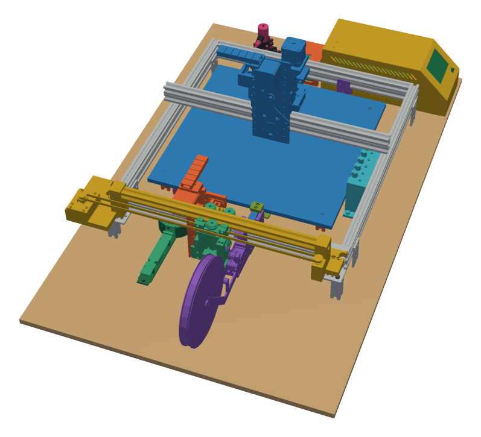
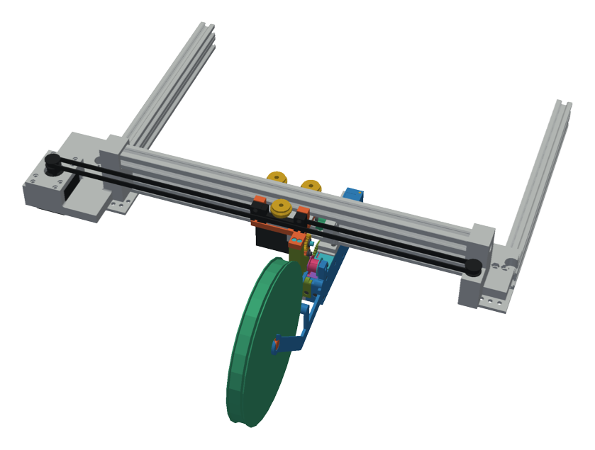
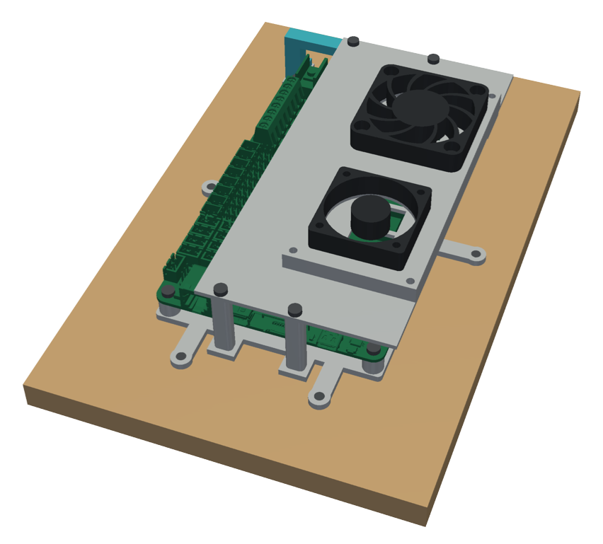
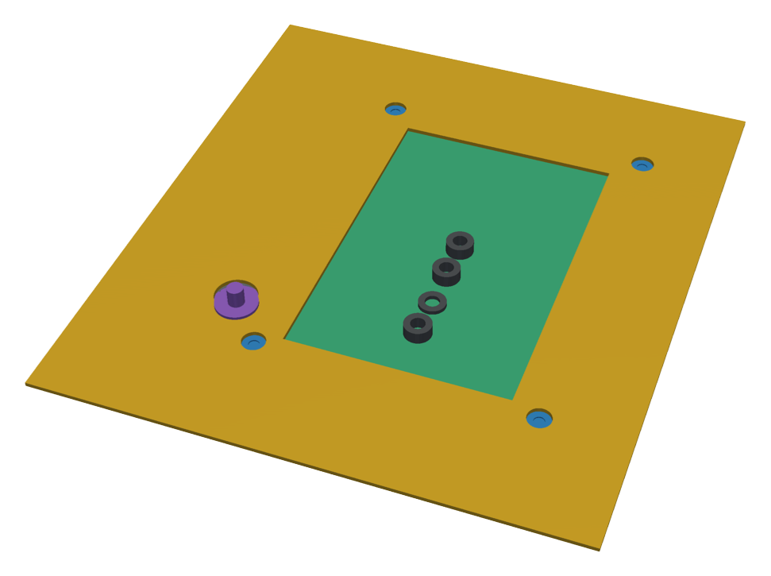
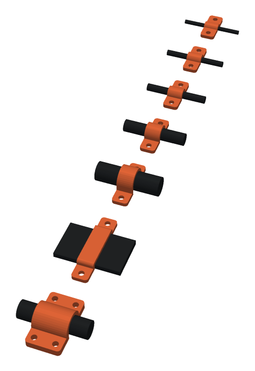
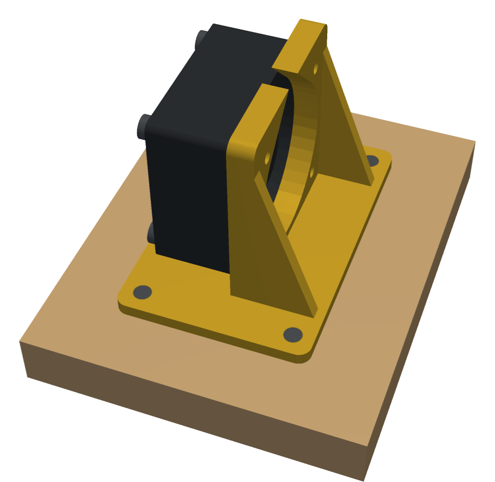
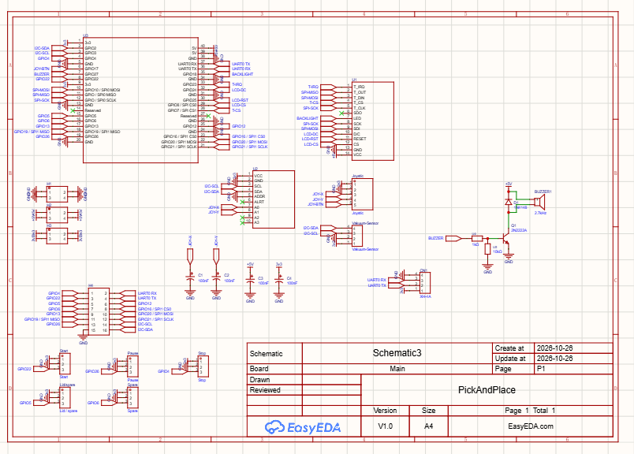
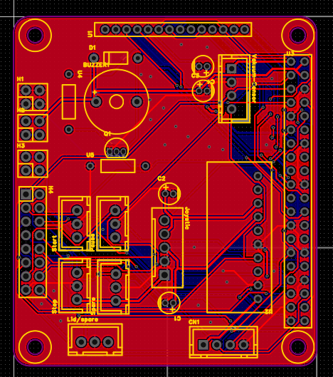
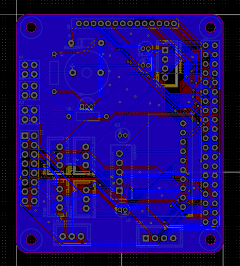
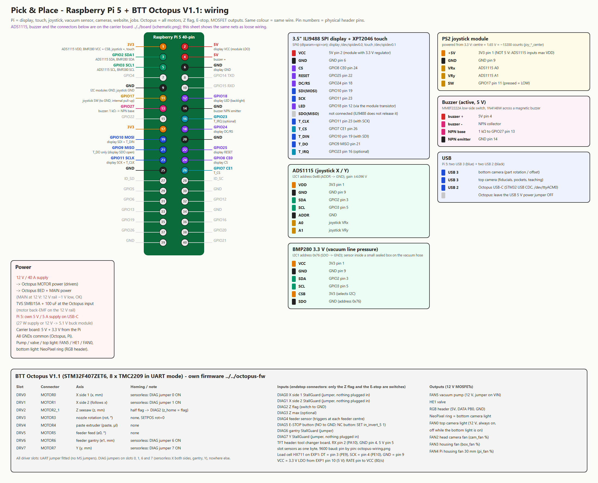

# PickAndPlace

A DIY SMD pick-and-place machine and paste dispenser built from a Creality CR-10S frame, a
**Raspberry Pi 5** and a **BTT Octopus V1.1**. The head has a belt-driven *seesaw Z*: one motor lowers the
vacuum picker while it raises the paste syringe, and the other way round. Next to it are a 5-slot Juki nozzle
changer, tape feeders on their own gantry, an up-looking camera with an LED ring, a vacuum sensor and a 3.5"
touch display with a joystick.

  

- **Software** (Pi setup, building, the display, the website, simulation): [SOFTWARE.md](SOFTWARE.md)
- **3D models** (STEP, one folder per part): [models/](models/)
- **Wiring**: [hardware/](hardware/)

---

## Contents

- [3D models](#3d-models)
- [Electronics and schematics](#electronics-and-schematics)
- [Bill of materials](#bill-of-materials)
- [Screws](#screws)
- [Tools](#tools)

---

## 3D models

All renders are made from the models in [models/](models/). Each folder holds the STEP files of that unit:
`assembly.step` shows everything in place, and the other files are the single parts. Open them in FreeCAD,
Fusion 360 or any other CAD program, or export the printed parts to STL for slicing.

### Head (seesaw Z)

A 3 mm aluminium plate (82 × 218 mm) is bolted to the CR-10 X-carriage. Two MGN9 rails carry the tools. A
NEMA17 at the top drives one 6 mm GT2 belt loop: the **picker** (NEMA 8 rotation head with a Juki nozzle) hangs
on one side of the loop and the **paste syringe** on the other. When one goes down, the other comes up.

- Travel ±62 mm to the hard stop, ±55 mm working stroke
- An optical home sensor finds the centre
- The top camera sits in front for fiducials and tape pockets

[models/head-mount](models/head-mount/) · picker bracket: [models/nema8-90deg-mount](models/nema8-90deg-mount/)

 

### Nozzle changer

Five slots for Juki 500 nozzles. The nozzle slides in from the front, and when the head lifts, the lid lip
holds the collar and pulls the nozzle off. A TCRT5000 sensor behind each slot sees whether a nozzle is
there.

[models/juki-tool-changer](models/juki-tool-changer/)

 

### Feeders

Tape feeders for 7" reels ride on a rail of their own (the feeder gantry). Each feeder has a sprocket drive,
a peel-off spool, a WS2812 status LED and a QR code that the top camera reads during auto-detect.

[models/feeder](models/feeder/)

 

### More units

| | | |
|:-:|:-:|:-:|
|  **Bottom camera** up-looking camera with a 16-LED ring · [folder](models/bottom-camera/) |  **Vacuum pump** sits on springs to soak up vibration · [folder](models/pump-mount/) |  **Vacuum sensor** sealed BMP280 housing on the hose · [folder](models/vacuum-sensor/) |
|  **Control box** CR-10S housing with the Octopus and display · [folder](models/control-box/) |  **Octopus mount** board and driver fans on the MDF · [folder](models/octopus-mount/) |  **Pi housing** Pi 5, carrier board and a 30 mm fan · [folder](models/pi-housing/) |
|  **Display console** 3.5" touch display and joystick · [folder](models/display-mount/) |  **CR-10S display adapter** display in the original CR-10S box · [folder](models/cr10s-display-adapter/) |  **Cable chain mount** on a 2020 V-wheel carriage · [folder](models/chain-mount/) |
|  **Cable clamps** for round and flat cables · [folder](models/cable-clamp/) |  **Wire holders** on the MDF · [folder](models/wire-holder/) |  **Box fan stand** fan for the control box · [folder](models/box-fan-mount/) |

---

## Electronics and schematics

The **Pi 5** runs the jobs, the display, the cameras, the sensors and the website. The **Octopus** runs its own
firmware: it only moves the 8 motors, reads the endstops and switches the 12 V outputs. The two talk over USB.

### Carrier board for the Pi

A small board on the Pi's 40-pin header. It holds the ADS1115 for the joystick, the buzzer, and connectors for
the display, the vacuum sensor, the joystick and the start / pause / stop buttons.

| Front | Back |
|:-:|:-:|
|  |  |

### Wiring

Every connection from the Pi to the display, joystick, sensors, buzzer and cameras, plus how the motors,
inputs and outputs are laid out on the Octopus:

The Octopus connectors pin by pin:

| Octopus slot | Motor |
|---|---|
| DRV0 / DRV1 | X, both sides (sensorless homing) |
| DRV2 | Z seesaw (home flag) |
| DRV3 | Nozzle rotation (NEMA 8) |
| DRV4 | Paste extruder |
| DRV5 | Feeder feed |
| DRV6 | Feeder gantry (sensorless homing) |
| DRV7 | Y (sensorless homing) |

---

## Bill of materials

Prices are what I paid (EUR, Nov 2026). The total is **about €623** for 47 items; €18 of that is optional.
Tools are listed separately because you may already have them.

### Electronics and control

| Part | Used for | Qty | Price | Shop |
|---|---|:-:|--:|---|
| [BIGTREETECH BTT Octopus V1.1, 32-bit, with TMC2209 drivers](https://de.aliexpress.com/item/1005002611546395.html) | Motion board: 8 motors, endstops, 12 V outputs | 1 | 54.66 | AliExpress |
| [diymore ESP32-S3 DevKitC-1 N16R8, 2 pcs](https://www.amazon.de/dp/B0FKBPJRQC) | Controller | 1 | 17.98 | Amazon |
| [Binghe 3.5" TFT SPI touch display, ILI9488, 320 × 480](https://www.amazon.de/dp/B0G2C3NWFD) | Machine display | 1 | 14.99 | Amazon |
| [leruiyezs ADS1115 ADC module, 16-bit, 4 ch, I2C](https://www.amazon.de/dp/B0G7CGFY8G) | Reads the joystick X / Y | 1 | 8.99 | Amazon |
| [Hall effect analog sticks (PS5), pack of 4](https://www.amazon.de/dp/B0D7CVV966) | Joystick | 1 | 9.99 | Amazon |
| [QIQIAZI DC-DC buck converter, 10–90 V to 5 V 5 A, USB-C](https://www.amazon.de/dp/B0FMJXJL6S) | 5 V supply for the Pi from 12 V | 1 | 11.99 | Amazon |
| [2×20 pin female header, 2.54 mm, pack of 10](https://www.amazon.de/dp/B0GSVZD1CP) | Carrier board on the Pi header | 1 | 10.97 | Amazon |
| [ELEGOO double-sided prototype PCB kit, 32 pcs](https://www.amazon.de/dp/B0734XYJPM) | Carrier board | 1 | 14.99 | Amazon |
| [ALLECIN electrolytic capacitor assortment, 0.1–1000 µF](https://www.amazon.de/dp/B0C1VBXCQM) | Carrier board, 12 V input buffer | 1 | 10.99 | Amazon |
| [Youmile optical endstop module with 1 m cable, 6 pcs](https://www.amazon.de/dp/B09BTMDW5P) | Z home flag, feeder sensor | 1 | 10.99 | Amazon |
| [Joycabin WS2812 RGB LED ring, 16 LEDs, pack of 4](https://www.amazon.de/dp/B0H2PW6HJT) | Bottom camera light | 1 | 8.95 | Amazon |
| [DAOKAI micro limit switch with roller lever, 20 pcs](https://www.amazon.de/dp/B09YYJ23Z4) | *Optional:* only if you don't use sensorless homing or optical sensors | 1 | 6.69 | Amazon |
| | | | **182.18** | |

### Motion (frame and gantry)

| Part | Used for | Qty | Price | Shop |
|---|---|:-:|--:|---|
| [STEPPERONLINE NEMA 17, 42 Ncm, 1.5 A, 5 pcs](https://www.amazon.de/dp/B0B38H2ZMR) | X / Y / Z / feeder motors | 1 | 35.00 | Amazon |
| [QitinDasen GT2 belt 6 mm, 5 m, with pulleys, idlers, tensioners](https://www.amazon.de/dp/B07SHB3NBV) | Seesaw Z belt, feeder gantry | 1 | 15.49 | Amazon |
| [Cable chain, 1 m](https://www.aliexpress.com/item/1005007435939757.html) | Cables to the head | 1 | 7.30 | AliExpress |
| [Caianwin M3 T-slot hammer nuts, 20-series, 100 pcs](https://www.amazon.de/dp/B0D3HJJS47) | Mounting parts on the 2020 profiles | 1 | 4.99 | Amazon |
| | | | **62.78** | |

### Head and nozzle

| Part | Used for | Qty | Price | Shop |
|---|---|:-:|--:|---|
| [QUARKZMAN MGN9 rail 200 mm with MGN9H block, 2 pcs](https://www.amazon.de/dp/B0G1M7SF5H) | Seesaw Z rails (picker and paste) | 1 | 24.29 | Amazon |
| [Watris Veiyi linear rail 100 mm, 9 mm, with block](https://www.amazon.de/dp/B0FDQXXCH6) | Tool carriers | 2 | 20.78 | Amazon |
| [Aluminium sheet 3 mm, 150 × 250 mm](https://www.amazon.de/dp/B086BM9VDW) | Head plate (82 × 218) | 1 | 14.45 | Amazon |
| [NEMA 8 PnP rotation head](https://www.aliexpress.com/item/1005005986790652.html) | Picker: hollow shaft, nozzle rotation | 1 | 33.69 | AliExpress |
| [Juki nozzle](https://www.aliexpress.com/item/4000086185928.html) | Picker nozzle (fits the nozzle changer) | 1 | 7.02 | AliExpress |
| | | | **100.23** | |

### Vacuum

| Part | Used for | Qty | Price | Shop |
|---|---|:-:|--:|---|
| [TICFOX micro diaphragm vacuum pump, 12 V, 12 L/min](https://www.amazon.de/dp/B0CG5GY1CQ) | Vacuum for the picker | 1 | 14.99 | Amazon |
| [DEWIN micro vacuum pump, 12 V DC](https://www.amazon.de/dp/B07DVBQJCR) | Vacuum pump | 1 | 8.19 | Amazon |
| [HAXIHA PU hose 4 / 2.5 mm, 15 m, with 14 connectors](https://www.amazon.de/dp/B0DQ7YXMZR) | Vacuum line from the pump to the nozzle | 1 | 10.99 | Amazon |
| [Hailege BMP280 pressure sensor (3.3 V), 5 pcs](https://www.amazon.de/dp/B0BN1NXG4D) | Vacuum sensor: is a part on the nozzle? | 1 | 6.89 | Amazon |
| [KitchenRaku silicone mat, 60 × 40 cm](https://www.amazon.de/dp/B0GQ2XBMS4) | *Later:* vacuum table, not needed yet | 1 | 11.04 | Amazon |
| | | | **52.10** | |

### Solder paste

| Part | Used for | Qty | Price | Shop |
|---|---|:-:|--:|---|
| [Luer lock syringes 5 ml, without needle, 30 pcs](https://www.amazon.de/dp/B0B4V724PY) | Paste syringe on the head | 1 | 10.99 | Amazon |
| | | | **10.99** | |

### Wiring

| Part | Used for | Qty | Price | Shop |
|---|---|:-:|--:|---|
| [4-wire silicone cable](https://de.aliexpress.com/item/1005005633799769.html) | Motor cables | 1 | 15.41 | AliExpress |
| [Henakmsl 12 AWG silicone cable, 5 m (red + black)](https://www.amazon.de/dp/B0B7B2H8B9) | 12 V power to the Octopus | 1 | 12.99 | Amazon |
| [URCIANOW 2-core wire 0.2 mm², red / black, 15 m](https://www.amazon.de/dp/B0F4QXYJGH) | Fans, sensors, LEDs | 1 | 7.99 | Amazon |
| [QUARKZMAN ribbon cable, 10-pin, 1.27 mm, 4 m](https://www.amazon.de/dp/B0G15JT5KL) | Signal cables | 1 | 8.19 | Amazon |
| [QUARKZMAN rainbow ribbon cable, 14-pin, 1.27 mm, 9 m](https://www.amazon.de/dp/B0DTYGHTHQ) | Signal cables | 1 | 14.29 | Amazon |
| [JST XH 5-pin cable, female–female, 20 cm, 20 pcs](https://www.amazon.de/dp/B0G5XT59S7) | Sensor connections | 1 | 8.99 | Amazon |
| [JST-XH connector kit, 2–6 pin](https://www.amazon.de/dp/B0BZHR5NCR) | Your own cables | 1 | 7.98 | Amazon |
| [Gorffy fork cable lug assortment, 0.5–6 mm², 260 pcs](https://www.amazon.de/dp/B0CBS514LL) | Power supply terminals | 1 | 7.63 | Amazon |
| | | | **83.47** | |

### Fasteners and consumables

| Part | Used for | Qty | Price | Shop |
|---|---|:-:|--:|---|
| [M3 heat-set inserts, M3 × 4 × 5 mm, 200 pcs](https://www.amazon.de/dp/B0D17FGQWW) | Every M3 screw into a printed part | 2 | 17.98 | Amazon |
| [M3 stainless hex socket screw assortment, 1320 pcs](https://www.amazon.de/dp/B0DZWR53CD) | M3 screws, all lengths | 1 | 10.88 | Amazon |
| [M3 socket head cap screw set with nuts & keys, 645 pcs](https://www.amazon.de/dp/B0GYXBCS39) | M3 screws and nuts | 1 | 3.99 | Amazon |
| [M2 socket head cap screw set with nuts & keys, 675 pcs](https://www.amazon.de/dp/B0GYX8HPS6) | Motor mounts (NEMA 8) | 1 | 3.99 | Amazon |
| [Stainless spring assortment, 300 pcs, 23 sizes](https://www.amazon.de/dp/B0G19PLCMG) | Pump vibration mounts | 1 | 7.88 | Amazon |
| [eSUN PLA 1.75 mm, black, 4 kg](https://www.amazon.de/dp/B0FRFH9HYD) | All printed parts | 1 | 35.99 | Amazon |
| [Syprin precision mechanics oil, 100 ml](https://www.amazon.de/dp/B0948SPXZ9) | Linear rails and blocks | 1 | 9.99 | Amazon |
| | | | **90.70** | |

---

## Screws

| Size | Where |
|---|---|
| **M2** | Motor mount |
| **M3** | Every screw into plastic, always into a heat-set insert |
| **M5** | Joining the aluminium profiles |
| **Wood screws** (Spax 2 × 10 mm) | Parts onto the MDF base |

The model folders list the exact lengths for each part (for example M3 × 10 into the nozzle changer inserts).

---

## Tools

Not part of the machine, but they make the build a lot easier:

| Tool | Used for | Price | Shop |
|---|---|--:|---|
| [Retoo step drill set, 4–12 / 20 / 32 mm](https://www.amazon.de/dp/B0CLDP8CM4) | Holes in the aluminium plate and the CR-10S box | 6.89 | Amazon |
| [RICHMANN M3 hand tap set, 3 pcs](https://www.amazon.de/dp/B0BHL5Z2FW) | M3 threads in aluminium | 5.32 | Amazon |
| [KS Tools adjustable tap wrench, M1–M12](https://www.amazon.de/dp/B0099LPKW4) | Holds the taps | 5.89 | Amazon |
| [Preciva 2-in-1 crimping tool, Dupont & flat connectors](https://www.amazon.de/dp/B0D8KCHZK5) | JST / Dupont crimps | 16.14 | Amazon |
| [Mini 3-in-1 wire stripper / side cutter, 20–10 AWG](https://www.amazon.de/dp/B0FDQD4YRX) | Stripping and cutting wire | 6.79 | Amazon |
| | | **41.03** | |

You'll also need a soldering iron (for the carrier board and for pressing in the heat-set inserts), a 3D
printer and a drill.
